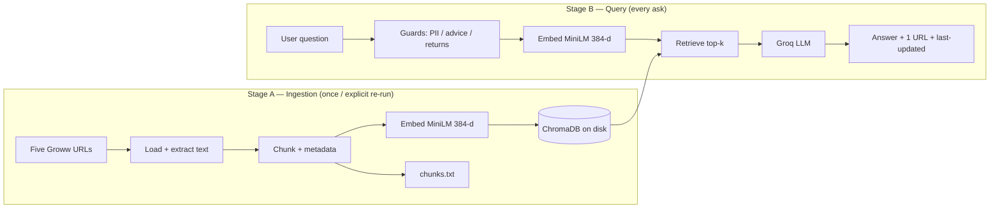
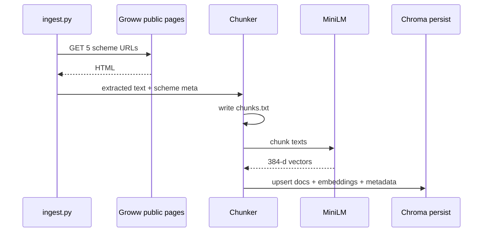
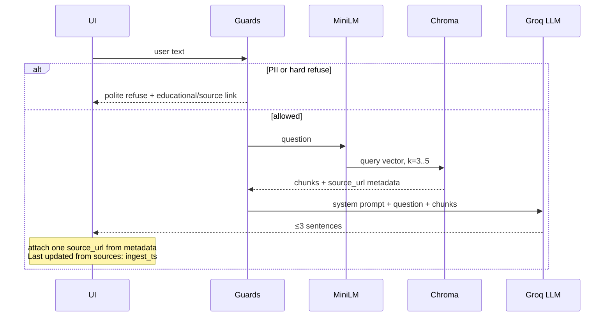

# Architecture: Groww HDFC Mutual Fund FAQ RAG Chatbot

**Product spec:** [PRD.md](./PRD.md)  
**Context:** Class demo — both RAG stages (ingestion and retrieval) must be visible and inspectable  
**Last updated:** 2026-10-13

---

## 1. Purpose

This document describes **how** the facts-only FAQ assistant is built: components, data flow, storage, and the two RAG stages. Product rules (scope, refusals, citations) live in the PRD; this file is the system design.

Teaching intent: an instructor should be able to walk **Load → Chunk → Embed → Store**, then **Question → Embed → Retrieve → LLM → Answer**, and open the chunk dump and Chroma persist folder.

---

## 2. High-level view

Two pipelines share one embedding model and one on-disk vector store. Ingestion runs **on demand**. Query runs **per user question**.



**Shared contract:** the same `sentence-transformers/all-MiniLM-L6-v2` model embeds **chunks and questions**. Chroma similarity is only valid if that stays true.

---

## 3. System components

| Component | Role | Notes |
| --- | --- | --- |
| Source catalog | List of 5 public URLs + scheme metadata | CSV/MD; only these pages are ingested |
| Loader | HTTP GET + HTML → plain text | Public pages only; no login |
| Chunker | Split text; attach metadata; write `chunks.txt` | Size/overlap chosen after inspecting pages |
| Embedder | MiniLM → 384-float vectors | Local; no API key |
| Vector store | Chroma persistent collection | Restart does **not** re-ingest |
| Retriever | Query embed + top-k similarity | Small `k` (3–5) |
| Policy guards | PII / advice / returns detection | Before or around LLM; deterministic where possible |
| Generator | Groq chat completion | Grounded prompt; ≤3 sentences |
| Citation binder | Pick **one** `source_url` from retrieved metadata | Prefer metadata over model-invented URLs |
| UI | Welcome, 3 examples, chat, disclaimer | Tiny; citation as a link |

---

## 4. Proposed layout (implementation)

Logical modules (names can match this tree):

```
Groww/
  PRD.md
  architecture.md
  sources.md                 # 5 URLs (deliverable)
  data/
    raw/                     # optional saved HTML/text after load
    chunks.txt               # inspectable dump (deliverable)
    chroma/                  # persist dir; gitignored
  src/
    ingest.py                # Load → Chunk → Embed → Store
    retrieve.py              # Question → Embed → top-k
    generate.py              # Groq + prompt + citation format
    guards.py                # PII / advice / returns
    app.py                   # UI (Streamlit or similar)
  .env                       # GROQ_API_KEY; gitignored
  sample_qa.md
  README.md
```

Ingestion is a **CLI** (`python src/ingest.py`). The app **loads** Chroma; it does not scrape on startup.

---

## 5. Stage A — Data ingestion

```
Load → Chunk → Embed → Store
```

### 5.1 Load

- Input: the five Groww Direct–Growth scheme URLs from the PRD / `sources.md`.
- Fetch public HTML; extract visible text (strip nav/chrome where practical).
- Record an **ingest timestamp** used later as `Last updated from sources: …`.
- Failure: skip or abort with a clear error; do not invent page content.

### 5.2 Chunk (strategy after inspection)

Before coding the splitter, inspect extracted text and record in README:

- Why the strategy fits Groww scheme pages (sectioned facts: ratios, loads, SIP, riskometer)
- **Chunk size** and **overlap**
- Metadata on every chunk:

| Field | Required | Use |
| --- | --- | --- |
| `source_url` | yes | The single citation URL |
| `scheme_name` | yes | Keep schemes from mixing |
| `category` | yes | large-cap / flexi / ELSS / small-cap / hybrid |
| `section_title` | optional | e.g. “Exit Load”, “Holdings” |
| `ingest_ts` | yes | Freshness line in the answer |

All chunks are written to a readable **`chunks.txt`** (scheme, URL, section, body) for class inspection.

### 5.3 Embed

- Model: `sentence-transformers/all-MiniLM-L6-v2`
- Output: 384-dimensional vectors
- Embed **chunk text** only (not the URL)

### 5.4 Store

- Chroma collection (e.g. `hdfc_mf_faq`)
- Persist directory on disk (e.g. `data/chroma`)
- Each record: `id`, `embedding`, `document` (chunk text), `metadata` (table above)
- Idempotency: re-ingest **replaces** the collection (explicit command only)



---

## 6. Stage B — Data retrieval and generation

```
Question → Embed → Retrieve top chunks → LLM → Answer
```

### 6.1 Query path



### 6.2 Guards (before generation)

Run **deterministic** checks so refusals do not depend on the LLM alone:

| Guard | Trigger (examples) | Behavior |
| --- | --- | --- |
| PII | PAN, Aadhaar, account no., OTP, email, phone | Refuse; do not store or echo |
| Advice | buy/sell/switch, “best for me”, “should I” | Facts-only refuse + educational/official link |
| Returns | “return”, “CAGR”, “which performed better” | Do not compute; point to scheme/factsheet page |

If a guard fires, retrieval may be skipped (advice/PII) or used only to pick a relevant scheme URL (returns / missing-fact style).

### 6.3 Retrieve

- Embed the question with **the same MiniLM model**
- Similarity search in Chroma, `k` ∈ {3, 4, 5}
- Return chunk text + metadata (`source_url`, `scheme_name`, `ingest_ts`)

### 6.4 Generate

- Provider: Groq; key from `.env` (`GROQ_API_KEY`)
- Context: retrieved chunks **only** — no filling numbers from world knowledge
- Output contract (PRD):
  - ≤ 3 sentences
  - Name the scheme when relevant
  - **One** citation URL (from chunk metadata, not hallucinated)
  - `Last updated from sources: <ingest_ts>`
  - If the fact is not in chunks: say so; still cite a relevant scheme URL from retrieval

### 6.5 Citation

Citation is **bound from Chroma metadata**:

1. Prefer the URL of the highest-ranked chunk whose `scheme_name` matches the question.
2. Else URL of the top chunk.
3. Never invent a Groww/AMC URL in the model.

---

## 7. UI architecture

Single-page chat (e.g. Streamlit):

- Always-visible disclaimer: **Facts-only. No investment advice.**
- Welcome line (HDFC facts from public Groww pages, with sources)
- Three example question chips (PRD §9)
- Message list: user / assistant; citation as a clickable link; last-updated line
- Text input; no account, no file upload of statements, no PII fields

The UI talks only to the query pipeline. It does not write to Chroma except via a separate ingest command.

---

## 8. Data and secrets

| Artifact | Persist? | Git? |
| --- | --- | --- |
| `sources.md` / CSV | yes | yes |
| `data/chunks.txt` | yes | yes (demo inspect) |
| `data/chroma/` | yes, disk | **no** |
| `.env` Groq key | local | **no** |
| Chat history | optional in-session only | **no**; no PII |
| Raw HTML | optional cache | optional; public pages only |

---

## 9. Prompt contract (generator)

System instructions the architecture must enforce:

- Answer **only** from retrieved context
- Facts only; no “you should”, no buy/sell, no return claims
- If context is insufficient: say the fact is not in the sources
- Do not request or repeat PII

User message payload: question + numbered chunks (text + `source_url` + `scheme_name`).

---

## 10. Failure modes

| Failure | User-visible behavior |
| --- | --- |
| Chroma dir missing / empty | App tells user to run ingest; no fake answers |
| Groww fetch fail during ingest | Ingest exits with which URL failed |
| MiniLM load fail | Startup/ingest error; no query |
| Groq down / rate limit / bad key | Show retrieval still worked if useful, plus “generation unavailable” — **do not** guess facts |
| Empty retrieval | “Not in the five-scheme corpus” + link to `sources.md` or a default scheme page |
| Stale corpus | Honest `Last updated from sources`; re-ingest is the refresh path |

---

## 11. Security and compliance (demo-scale)

- Public HTTP only; no Groww session cookies or app backends
- Groq key only in `.env`
- No logging of PAN/Aadhaar/OTP/email/phone
- Closed corpus: answers cannot cite blogs that were never ingested

---

## 12. What to show in class

1. **`sources.md`** — the five URLs  
2. **`chunks.txt`** — tagged chunks after ingest  
3. **`data/chroma/`** — persist survives restart  
4. Live query: expense ratio / ELSS lock-in / min SIP  
5. Live refuse: “Should I buy HDFC Small Cap?”  
6. Architectural split: ingest CLI vs query path sharing MiniLM + Chroma  

---

## 13. Out of scope for this architecture

- Hybrid search, rerankers, multi-AMC indexes  
- Login, holdings APIs, statement download on behalf of the user  
- Computing or comparing returns  
- Re-embedding on every app boot  
- LLM-chosen citations without metadata binding  

---

## 14. Decision log (locked by PRD)

| Decision | Choice |
| --- | --- |
| Embedding | `all-MiniLM-L6-v2`, 384-d, local |
| Vector DB | Chroma, disk persist |
| LLM | Groq |
| Corpus | 5 HDFC Direct–Growth Groww pages |
| Citation | Exactly one URL per answer, from metadata |
| Ingest cadence | Explicit, not on startup |
| Retrieval `k` | 3–5 |
| Chunk size / overlap | **TBD after page inspection** (README) |
